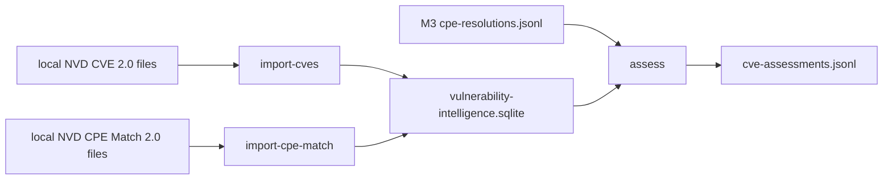

# M4 — Offline CVE intelligence and conservative applicability

## Goal

M3 can assign a canonical CPE name to some detected products. M4 correlates those verified CPE name UUIDs with a local NVD CVE 2.0 dataset and evaluates NVD's configuration tree. A CPE identity match, a CVE applicability match, and a confirmed vulnerability are different claims. M4 never emits `confirmed_vulnerable`. The strongest status is `potentially_affected`.

M1, M2, and M3 behavior is unchanged. M3 limitations remain: the official CPE dictionary was not imported, exact dictionary matching has no version ranges, and M2 resume is still at-least-once.

## Architecture



`app/vulnerability/` is separate from `app/cpe/`. The M4 database is not the M3 dictionary.

## Data flow

1. Import yearly CVE JSON feeds (`--kind initial`, the default unless the path contains `modified` or `recent`).
2. Import later Modified or Recent feeds with `--kind incremental`. They upsert by CVE ID. An incremental import into an empty database is accepted and marked incomplete. It does not replace a missing baseline.
3. Import the CPE Match feed. `matchCriteriaId` values are stored with the expanded `cpeName` / `cpeNameId` list and the version-range fields. ASA does not invent a version ordering. Applicability uses the expanded names.
4. `assess` reads M3 JSONL one line at a time and writes one line per input record. It does not merge records into an asset. M2 has no reliable cross-record asset id.

Verified inventory for a record is a candidate with `resolution_status == exact_match`, a non-empty `cpe_name_id`, `deprecated` not true, and `evidence_strength` either `strong` or absent. `review_required`, `product_only`, `ambiguous`, `no_match`, `deprecated_only`, `skipped_weak`, and weak evidence are not inventory.

## Feed formats supported

Both importers accept a local `.json` file, a `.json.gz` file, a `.zip` whose members are `.json` or `.json.gz`, or a directory of those files. NVD's CVE 2.0 files are gzip-compressed JSON documents named like `nvdcve-2.0-YYYY.json.gz`, `nvdcve-2.0-recent.json.gz`, and `nvdcve-2.0-modified.json.gz`, with an optional sibling `.meta` file. If the meta file has a `sha256` line, it must match the file bytes or the import fails before commit.

CVE document header, checked before records are inserted:

- `format` must be `NVD_CVE`
- `version` must be `2.0`
- records are the objects in `vulnerabilities[]`, each wrapping a `cve` object

Stored CVE fields: `id`, `sourceIdentifier`, `published`, `lastModified`, `vulnStatus`, `descriptions`, `metrics`, `weaknesses`, `references`, `configurations`. Metrics are stored whole. Scores are not recalculated and no single CVSS version is chosen. A `Rejected` vulnStatus is stored and is never an active finding.

CPE Match document header:

- `format` must be `NVD_CPE_Match_String`
- `version` must be `2.0`
- records are `matchStrings[].matchString`

Stored match fields: `matchCriteriaId`, `criteria`, `status`, `versionStartIncluding`, `versionStartExcluding`, `versionEndIncluding`, `versionEndExcluding`, `created`, `lastModified`, `cpeLastModified`, and each `matches[]` pair of `cpeName` and `cpeNameId`.

A criteria string, an official CPE name, and an M3-resolved CPE name are different. The evaluator compares M3 `cpe_name_id` values to official `cpeNameId` values under a `matchCriteriaId`. It does not string-compare the criteria expression.

## SQLite schema

Database suggestion: `out/vulnerability-intelligence.sqlite` (`PRAGMA user_version = 1`).

- `cve_entries` — one row per CVE ID, JSON columns for descriptions, metrics, weaknesses, references, and configurations
- `cve_criteria` — `(cve_id, match_criteria_id)` extracted from the configuration tree, indexed by criteria id
- `cpe_match_criteria` — one row per match criteria id, including version-range text and status
- `cpe_match_entries` — `(match_criteria_id, cpe_name_id, cpe_name)`, indexed by CPE name id
- `feed_imports` — append-only log of filename, checksum, schema version, timestamp, import type, and time
- `feed_metadata` — latest CVE and CPE Match schema versions and timestamps, plus `incomplete_cve_import`

Re-import upserts by CVE ID or match criteria id. Child CPE name rows for a criteria id are replaced. The same CVE id cannot appear twice.

## Evaluation

NVD publishes a list of configurations. Any one configuration can make the CVE applicable, so the roots are combined with OR. Inside a configuration, nodes use the configuration operator, default AND. A node uses AND or OR over its `cpeMatch` leaves and nested `children`. `negate: true` swaps TRUE and FALSE and leaves UNKNOWN unknown.

Three-valued Kleene logic:

| Operator | Result |
| --- | --- |
| AND | FALSE if any child is FALSE; else UNKNOWN if any child is UNKNOWN; else TRUE |
| OR | TRUE if any child is TRUE; else UNKNOWN if any child is UNKNOWN; else FALSE |
| NOT | swaps TRUE and FALSE; UNKNOWN stays UNKNOWN |

A leaf is TRUE only when all of the following hold:

- `matchCriteriaId` is present
- `vulnerable` is a boolean
- the local CPE Match database has that criteria id
- status is `Active` or absent
- the expansion includes at least one concrete `cpeNameId`
- that id is in this record's verified inventory

Anything else on the leaf is UNKNOWN, including a missing mapping, an inactive criteria, an empty expansion, and a product the scan did not observe. Absence is not FALSE. A missing mapping is incomplete intelligence, not a negative result.

`potentially_affected` requires the tree to be TRUE and at least one TRUE leaf to have `vulnerable: true`. A TRUE tree whose TRUE leaves are only `vulnerable: false` is `context_only`. A platform match alone does not create a finding. If a required sibling is UNKNOWN, an AND stays UNKNOWN and the status is `not_evaluated` even if the vulnerable product was seen.

## Assessment record

One JSON object per input line. Per-CVE statuses:

| Status | Meaning |
| --- | --- |
| `potentially_affected` | A configuration evaluated TRUE and a vulnerable CPE leaf matched |
| `not_evaluated` | Inventory, mapping, operator, or another condition was incomplete |
| `context_only` | Only contextual or platform leaves matched |
| `rejected` | `vulnStatus` is Rejected; not an active vulnerability |

`no_match_in_local_feed` is a record-level `dataset_status` used when verified CPE names are present and no CVE assessment was produced. The note says this does not mean the asset is secure. CVEs whose tree is FALSE are omitted rather than described as safe.

Evidence keeps candidate ids, matched `cpeNameId`s, matched criteria ids, and a configuration path. CVSS objects keep every source and version that NVD supplied. CWE values are copied from NVD weaknesses and are not invented.

## CLI

```bash
python3.11 -m app.vulnerability.cli import-cves \
  --source ./local-data/nvd-cves/ \
  --db ./out/vulnerability-intelligence.sqlite

python3.11 -m app.vulnerability.cli import-cves \
  --source ./local-data/nvd-cves/modified/ \
  --db ./out/vulnerability-intelligence.sqlite \
  --kind incremental

python3.11 -m app.vulnerability.cli import-cpe-match \
  --source ./local-data/nvd-cpe-match/ \
  --db ./out/vulnerability-intelligence.sqlite

python3.11 -m app.vulnerability.cli assess \
  --input ./out/cpe-resolutions.jsonl \
  --output ./out/cve-assessments.jsonl \
  --db ./out/vulnerability-intelligence.sqlite
```

Assessment refuses to overwrite its input. A missing database, a database that is not M4 schema version 1, or a database without both a CVE import and a CPE Match import fails before any output is trusted.

## Memory and chunking

Zip members and directory files are opened one at a time. The JSON array is decoded with `JSONDecoder.raw_decode` so only one CVE or match string is materialized at a time. The header before that array must fit in 1 MiB. One object must fit in 64 MiB. Match-name inserts are batched at 500 rows. Each top-level file is one transaction: a malformed member rolls that file back and leaves earlier files committed.

Measurement, Linux `ru_maxrss` in kilobytes, child process that only imported a synthetic feed: 2,000 CVE records, 846,968 bytes of JSON, 13,458 bytes gzipped, peak RSS 20,028 KB. This does not measure the official CPE Match feed (about 836 MB compressed when this milestone was specified). That feed was not downloaded.

## Privacy

Import and assessment take local paths only. There is no NVD API client, no HTTP client, and no LLM client. Scan data is not an input to the importers. GitHub Actions uses the synthetic fixtures in `tests/fixtures/` and does not receive `Data/PartOfMe.json`. The release archive allow-list is application source, schemas, docs, tests, workflows, the license, and the README. `Data/PartOfMe.json`, `out/`, and SQLite files are excluded.

## Tests

`python3.11 -m unittest discover -s tests -v` — 105 tests, OK, on 2026-11-03. That includes the previous 61 M1–M3 tests. New coverage is CVE import, CPE Match import, the configuration evaluator, the assessment pipeline (including an M2 fixture through M3 into M4), and the release archive contents.

Official NVD CVE and CPE Match feeds were not imported. A synthetic fixture is not evidence of a full-feed import.

## CI and CD

`.github/workflows/tests.yml` runs on pull requests, pushes to `main`, and `workflow_dispatch`. It compiles, runs the full suite, runs the M4 CLI against synthetic fixtures, and uploads logs. `.github/workflows/release.yml` runs the suite and uploads `asa-source.tar.gz` plus a SHA-256 file on pull requests and manual runs. It publishes a GitHub Release only for a `v*` tag. No tag was created for M4.

The workflow result URLs are recorded in [m4_acceptance.md](m4_acceptance.md) after the GitHub Actions runs complete.

## Limitations

- Full official NVD CVE and CPE Match feeds were not imported.
- The M3 dictionary used in tests is still the small synthetic fixture. Version ranges are not applied inside M3.
- A criteria id with no local row is UNKNOWN, which can hide a CVE that would have matched a complete match feed.
- Negating FALSE becomes TRUE without restoring a vulnerable-product leaf, so a double negation is not reconstructed as `potentially_affected`. NVD trees in the fixtures do not rely on that shape.
- `no_match_in_local_feed` and an empty assessment list are not a statement that the host is safe.
- The 4 GB scan set was not tested.
- M2 checkpoint resume remains at-least-once.
